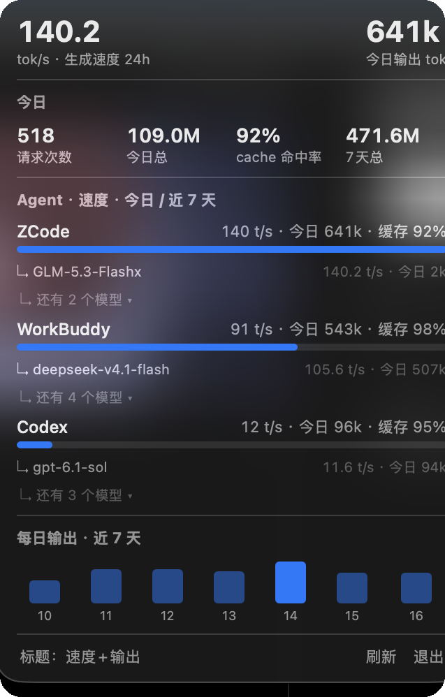

# ⚡ ZUsage

[](https://github.com/wsj414855138-code/zusage/actions/workflows/ci.yml)
[](LICENSE)


**macOS 菜单栏仪表盘：把多个 AI 编码 Agent 的 token 用量与生成速度，装进一个弹窗。**
One popover for all your AI coding agents — ZCode / Codex / WorkBuddy / Pi / Kimi Code.

纯本地运行：只读各 Agent 自己的日志，**无网络请求、无遥测、零依赖**。

<p align="center">
  
</p>

## 为什么做这个

同时用多个 AI CLI（ZCode、Codex、WorkBuddy、Pi…），各家各记各的账，你不知道：

- 今天谁烧的 token 最多？
- 哪个模型生成最快，快多少？
- 哪个 Agent 一周没动了？

ZUsage 把它们聚进一个菜单栏弹窗，60 秒自动更新。

## 效果示例

菜单栏面板（每 Agent 一行：速度 + 今日用量合一，模型行点击展开）+ 终端报表：

```text
$ zusage
多 Agent 用量 · 近 7 天

Agent          今日记录       今日输出      累计记录        累计输出      累计费用
ZCode            54        34k        64         34k         —
Codex            45        20k      1579        1.2M         —
WorkBuddy        25        57k       471        285k         —
Pi                0          0       119        138k     $4.10

生成速度（近 24h · 有逐请求耗时的来源）
Agent · 模型                                     tok/s     请求
WorkBuddy · kimi-k3-1                          176.7     17
ZCode · GLM-5.3-Flashx                         131.6     36
WorkBuddy · deepseek-v4.1-flash                 94.9      5
Codex · gpt-6.1-sol                             18.1   1530
Pi · k3                                         23.7     99
```

## 快速开始

前提：macOS 12+，装好 Xcode 命令行工具（`xcode-select --install`）。

```bash
git clone https://github.com/wsj414855138-code/zusage.git
cd zusage
bash install.sh
```

装完菜单栏出现 ⚡ 图标，点击弹出面板；`zusage` 命令装在 `~/.local/bin/`（提示找不到命令就把它加进 PATH）。项目 clone 到哪个目录都行——安装脚本会把采集器部署成运行时副本，详见[常见问题](#常见问题)。

- **更新**：本地安装不会静默自动跟 GitHub 同步。想更新时跑一次 `zusage --update`
  （或 `bash update.sh`）：拉取最新代码 → 重新构建安装，10 秒完成。不做后台静默更新
  是刻意的：项目在 `~/Desktop` 下时，launchd 定时更新会被 macOS TCC 拦截；把项目挪到
  桌面之外后可以再加全自动更新。

- 首次装登录项时 macOS 会弹一次「自动化」授权，允许则开机自启；拒绝也不影响使用。
- 面板只显示**你本机实际在用的** Agent，没用过的不会出现空行；任何 Agent 或模型 7 天无请求会自动从面板消失。
- **面板读法**（一行看全，点击展开）：
  - 每个 Agent 一行 = `速度 t/s · 今日输出`（24h 无样本时回退为 `今日 · 7天`），条形按速度占比；
  - 模型行按**窗口过滤**（对齐 ccusage：只列当前窗口内活跃的模型）——只有「今日有量或 24h 有
    速度样本」的模型单独成行；仅存在于 7 天窗口的旧模型折叠成一行汇总
    「近 7 天未活跃 · N 个模型 · 共 X tok」，展开才显示逐模型明细；
  - 模型默认显示**主力 1 行**，其余折叠成「还有 N 个模型 ▾」，点击展开/收起全部（同时带速度与用量）；
  - 头部两个数字 = 今日请求次数、7 天总输出；今日输入与 cache 读收在悬停提示里，
    并附 **cache 命中率**（= cache 读 ÷ (输入 + cache 读)，每个 Agent 行悬停也有）；
  - 头条速度是 ZCode 自己的实时值，今日输出是全部 Agent 聚合。
- 卸载：退出 App 后删 `~/Applications/ZUsage.app`、`~/Library/LaunchAgents/local.zusage.agentusage.plist`、`~/.zcode/cli/agent-usage/`，无其他残留。

## 监控对象

| Agent | 数据源（只读） | 粒度 | 速度 |
|---|---|---|---|
| ZCode | `~/.zcode/cli/db/db.sqlite`（`model_usage` 表） | 逐请求 | ✅ 首字到完成的真实耗时 |
| Codex | `~/.codex/sessions/**/*.jsonl` | 逐请求 | ✅ 墙钟窗口法还原 |
| WorkBuddy | `~/.workbuddy/projects/**/*.jsonl` | 逐请求 | ✅ 墙钟窗口法还原 |
| Pi | `~/.pi/agent/sessions/**/*.jsonl` | 逐请求 | ✅ 墙钟窗口法还原（唯一带真实美元成本） |
| Kimi Code | `~/.kimi-code/sessions/**/agents/*/wire.jsonl` | 逐请求 | ✅ 自带真实流式时长 `llmStreamDurationMs` |

Qoder、Kimi 桌面版、DeepSeek Harness、ima 等应用经排查**无本地逐请求 token 日志**，暂无法接入；新增数据源的通用方法见[接入你自己的 Agent](#接入你自己的-agent)。

## 速度是怎么算的

只有 ZCode 在数据库里记录了首字/完成时间戳。其余三家**没有耗时字段**，但日志每行带时间戳，且「工具结果落盘的时刻 ≈ 下一次模型请求的发出时刻」，于是：

```text
gen_ms = 本响应落盘 timestamp − 上一条工具结果的 timestamp
```

过滤 0.3s–10min 的异常窗口后入库。这个口径包含首字延迟与调度间隙，数值系统性略偏慢，但**跨 Agent 可比**——这正是「哪家快」这个问题想要的答案。

## 接入你自己的 Agent

架构就是「一个数据源一个函数」。任何把 token 用量写在本地的 CLI（Claude Code、Gemini CLI、OpenCode…）都能接，三步：

```python
# sync/sync.py
MYAGENT_LOGS = _path("ZUSAGE_MYAGENT_DIR", Path.home() / ".myagent" / "sessions")

def sync_myagent(con):
    """扫描日志 → 每次模型响应写一行。"""
    for f in MYAGENT_LOGS.rglob("*.jsonl"):
        for line in open(f, encoding="utf-8", errors="ignore"):
            j = json.loads(line)          # 找到你家的 usage 字段
            u = j.get("usage") or {}
            if not u.get("output_tokens"):
                continue
            write_token_row(con, "myagent", j["id"], j["timestamp"],
                            j.get("model"), "completed",
                            u["input_tokens"], u["output_tokens"],
                            u.get("cache_read", 0), None, None, "token")

def main():
    for name, fn in (..., ("myagent", sync_myagent)):
```

要点：

- **幂等**：行按 `(agent, key)` upsert，`key` 用日志里稳定唯一的 id（消息 id / 行号）。
- **口径归一**：`input_tokens` 必须是「不含缓存」的输入——若来源的 input 含 cached（如 Codex），入库前相减，否则 `input + cache` 双计。
- **速度**：来源没有耗时字段？照抄 `sync_pi` 的墙钟窗口法，用 `gen_ms` 列。
- **改了历史解析逻辑**：把该源的 `*_LOGIC_VERSION` 常量 +1，否则旧文件因签名未变不重读。

## 工作原理

```text
 各 Agent 本地日志            统一库                  展示
 ┌──────────────┐  60s    ┌─────────────────┐   ┌──────────────────┐
 │ zcode sqlite │──┐      │ ~/.zcode/cli/   │   │ 菜单栏 Popover    │
 │ codex jsonl  │──┼─sync─│ agent-usage/    │←──│ (Swift, 5s 刷新)  │
 │ wb jsonl     │──┤      │ usage.db (WAL)  │   │                  │
 │ pi jsonl     │──┘      └─────────────────┘   └──────────────────┘
                            ▲
                    launchd 定时同步
                    另: zusage CLI 直接读库
```

- **幂等**：所有行按 `(agent, key)` upsert，重复跑不重复计数。
- **增量**：文件按 `mtime:size` 签名跳过未变文件；提取逻辑版本号变更触发全量重读。
- **容错**：单个数据源失败不影响其他源；读库只读优先 + busy_timeout；同步失败面板保留旧值。
- **口径**：`unit=token` 是模型 token；`unit=quota` 保留给配额型数据源。

## 常见问题

**为什么 clone 到桌面后定时同步失败？**
macOS TCC 保护 `~/Desktop`：launchd 拉起的进程读桌面下的脚本会报 `Operation not permitted`。所以 `install.sh` 把 `sync/sync.py` 复制成运行时副本 `~/.zcode/cli/agent-usage/sync.py`，launchd 与 App 都指向副本——**改完采集器源码必须重跑 `bash install.sh` 重新部署**。

**面板数字是 0？**
面板数据有「60 秒采集 + 5 秒刷新」两级延迟；刚装完或刚才能用的 Agent 需要等一轮同步。
头部四格（今日输入 / cache 读 / 请求次数 / 今日输出）是**全部 Agent 的聚合值**——
ZCode 部分实时直读、其余经 60 秒同步；头条的速度数字则是 ZCode 自己的。

**某家的数字是配额还是 token？**
`usage.db` 的 `unit` 列标明口径；当前四家均为 `token`。接入配额型数据源时用 `unit=quota`，UI 会标注。

## 开发

```bash
python3 tests/smoke_test.py   # 32 项断言，离线 fixtures，不需要装任何 Agent
bash menubar/build.sh         # 改完 UI 重建 App
bash install.sh               # 改完采集器重新部署运行时副本
```

```text
zusage/
├── sync/sync.py        # 采集器：4 个适配器 + 统一库 + 增量/容错
├── menubar/            # Swift 菜单栏 App（build.sh 构建，make-icon.py 生成图标）
├── cli/zusage          # 终端报表
├── tests/              # 离线冒烟测试
├── launchd/            # launchd plist 模板（install.sh 按实际路径重新生成）
├── install.sh          # 一键安装/更新
└── docs/               # 截图
```

欢迎 PR 接入新 Agent——参照上面的三步，配上离线 fixtures 的测试用例即可。

## License

[MIT](LICENSE)
